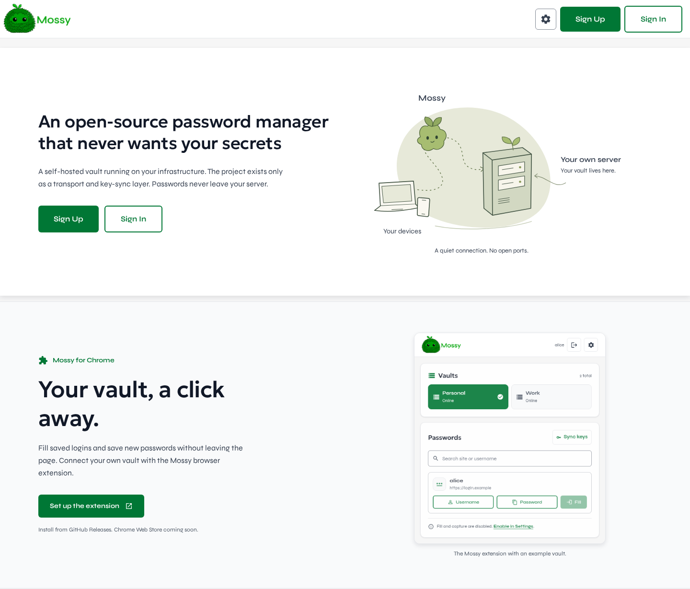
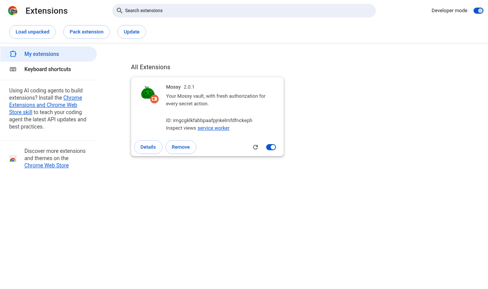
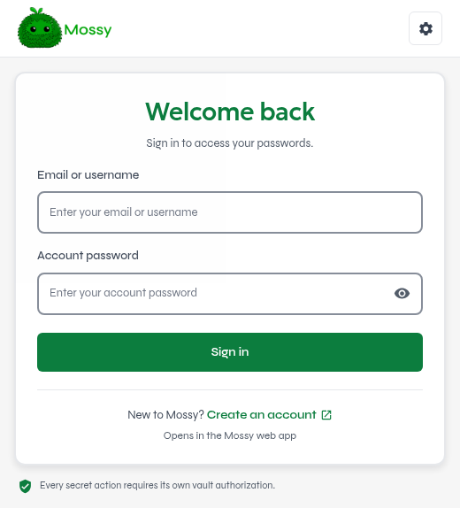
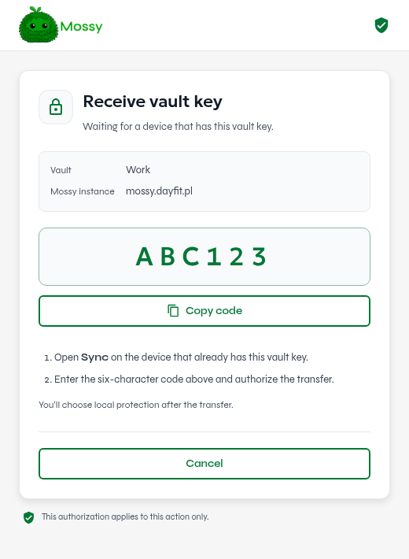
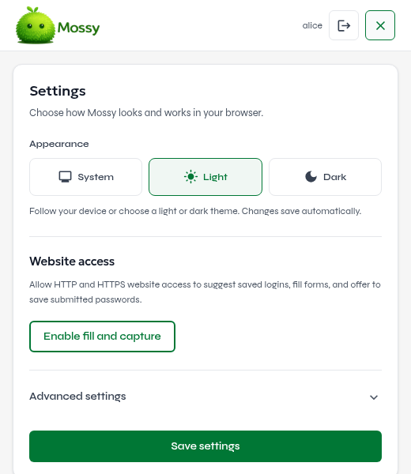
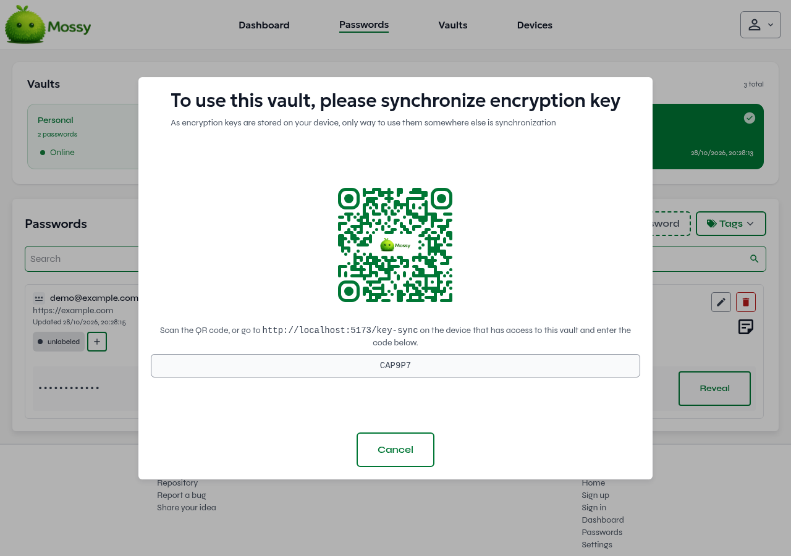
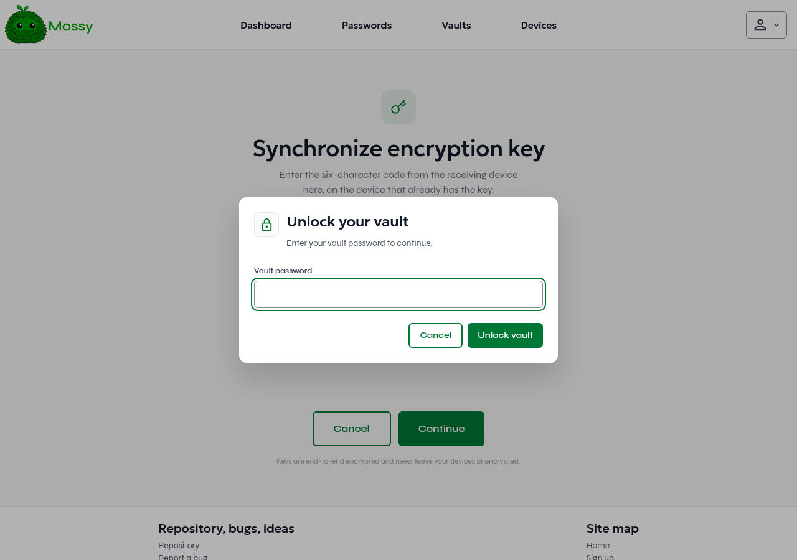
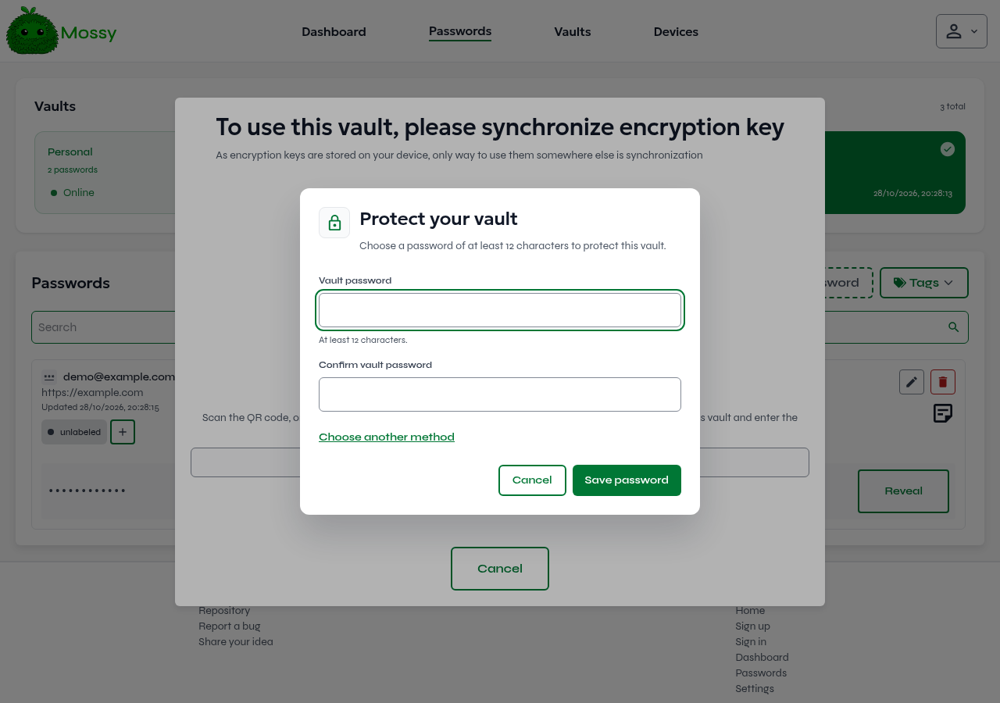
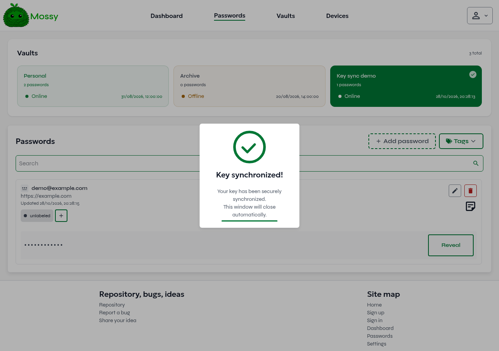

# Mossy

### Self-hosted password manager with a remotely accessible, end-to-end encrypted vault.


[](https://github.com/Day-fit/Mossy/actions/workflows/build-docker.yml)
[](https://deepwiki.com/Day-fit/Mossy)




## FAQ

- [Why Mossy?](#why-mossy)
- [Features](#features)
- [Architecture](#architecture)
- [Extension Setup](#extension-setup)
- [Key security properties](#key-security-properties)
- [Device trust](#device-trust)
- [Key synchronization](#key-synchronization)
- [Key synchronization under the hood](#key-sync-under-the-hood)
- [Threat model](#threat-model)
- [Tech stack](#tech-stack)
- [Running locally](#running-locally)
- [Tests](#tests)
- [Limitations](#limitations)

## Why Mossy?

Mossy is designed so you can avoid typical self-hosting pain while keeping the majority of the benefits. You no longer need to worry about putting infrastructure on a VLAN, forwarding ports securely, or configuring a VPN. The vault makes an outbound STOMP-over-WebSocket connection to Mossy's relay, so you don't need to worry about this mess. Also, thanks to E2EE, your secret data remains encrypted even if your vault or the relay is compromised.

\* This assumes that your device, browser, and the frontend code delivered to it are not compromised, and that your vault key remains secret.

## Features

- Passwords can be accessed remotely via a backend relay over STOMP/WebSockets
- You can control which devices are blocked or allowed (an already-issued access token may remain valid for up to 15 minutes, the default token lifetime)
- A device enrollment system is provided (a device needs to be explicitly allowed to use an account)
- Cross-device key sync is accessible via the backend
- Basic SSH key support
- Password and SSH-key secret fields, as well as notes, are E2EE
- Passwords are stored locally in your vault
- There is a tag and search system
- You can add encrypted notes to passwords as well

## Architecture

Mossy is built using a hybrid architecture. It uses a backend relay (hosted by us) that makes accessing passwords from any location possible. The self-hosted vault connects to the relay via STOMP over WebSockets; thanks to that, you don't have to worry about a firewall or opening ports on your router.

### Backend

Mossy's backend is built using a microservice architecture. Thanks to that, if something goes wrong with statistics-related code, password access is still possible. [Precise breakdown](https://deepwiki.com/Day-fit/Mossy)

Authentication, token claims, JWKS rotation, and resource-server configuration are described in the [authentication guide](docs/authentication.md).

### Browser extension

Provides suggestions for filling in passwords and captures passwords.

### Vault

The vault is the place where your passwords are stored. It has its own database containing entry metadata (such as identifiers, addresses, and tags) and encrypted secret blobs, but it cannot see your vault keys, as they remain on your devices.

## Extension Setup

For now, install the extension manually using the ZIP from [GitHub Releases](https://github.com/Day-fit/Mossy/releases). It will be available in the Chrome Web Store soon.

Use Chrome 137 or newer. You will need a [Mossy account](https://mossy.dayfit.pl/register), an online vault, and a device that already has its vault key. If you haven't set up a vault yet, follow [Run only the vault](#run-only-the-vault-probably-what-you-are-looking-for) first.

### Install the extension

1. Open [Releases](https://github.com/Day-fit/Mossy/releases), expand **Assets**, and download the Chrome extension ZIP. Choose the packaged extension, not GitHub's **Source code (zip)** archive.
2. Extract the ZIP into a folder you want to keep. Chrome loads the extension from this folder, so don't delete or move it after installation.
3. Open `chrome://extensions` in a new tab and enable **Developer mode** in the top-right corner.
4. Click **Load unpacked** and select the extracted folder containing `manifest.json`. Mossy should appear in the extensions list with its toggle enabled.

   

5. Click the puzzle icon in Chrome's toolbar and pin **Mossy**, then click the Mossy icon to open it.

### Sign in and sync your vault key

1. Enter your email or username and your **account password**, then click **Sign in**. The extension has its own login, so signing in to the Mossy website doesn't sign you in here.

   

2. If you see **Approve this browser**, open [Devices](https://mossy.dayfit.pl/devices) on a Mossy device you already use, approve the extension's device request, then sign in to the extension again.
3. Select your vault and click **Receive key**. You can also open **Sync keys** and click **Receive vault key**. A separate window will display a six-character receiving code; keep it open until the transfer finishes.

   

4. On the device that already has this vault key, open [Key sync](https://mossy.dayfit.pl/key-sync), enter the code from the extension, and unlock the vault when prompted to authorize the transfer. Use your own code; `ABC123` above is an example.
5. Back in the extension's receiving window, choose how to protect the key locally. For password protection, click **Use password**, enter and confirm a vault password, then click **Save password**. You can also choose one of the passkey options. This protects the vault key on this browser; your account password is used for signing in.
6. Once the transfer succeeds, click **Close** and reopen the popup. Repeat the key-sync steps for each vault you want to use in the extension.

### Enable filling and saving passwords

1. Open **Settings** using the gear icon. Under **Website access**, click **Enable fill and capture** and approve Chrome's permission request.

   

2. Close settings and refresh any login pages you already had open. Focus a username or password field to see matching saved logins, then select one and authorize the fill. Mossy can also offer to save passwords after you submit a login form.

Saved entries must include the website's full address (for example, `https://example.com`). Suggestions match the exact scheme, host, and port. Each fill, copy, or save action requires its own vault authorization using the protection you chose above.

## Key security properties

- When syncing your vault key to another device, Mossy uses **X25519** with an
  ephemeral key pair generated for each synchronization session. Compromising a
  long-lived device identity key later does not reveal keys transferred in earlier
  sessions (forward secrecy), provided the ephemeral private keys have been discarded.
- Password and SSH-key secret payloads, as well as notes, are encrypted with
  **AES-256-GCM**.
  The key never leaves your device in plaintext.

## Device trust

Device Trust is the source of truth for devices. Every login to Mossy relies on whether Device Trust's proof-of-possession challenge is passed. This microservice also provides a way to fetch a given device's public identity key, which is used during key synchronization.

## Key synchronization

The key synchronization process looks like this:

1. A new device interacts with a vault whose key is not yet stored on that device (e.g., it tries to add a new password or reveal an existing one).
2. A dialog displays a QR code and a six-character sync code. Keep it open while you transfer the key.

   

3. On the device that already has the key (from now on referred to as the **sender**), scan the QR code or open the URL displayed in the dialog. These screenshots use a local demo at `http://localhost:5173/key-sync`; for the public Mossy instance, open [Key sync](https://mossy.dayfit.pl/key-sync).
4. The sender enters the sync code and unlocks the vault with its vault password or passkey when prompted.

   

5. After receiving the key, the new device asks how to protect it locally. Choose a passkey option or **Use password**. For password protection, enter and confirm a vault password of at least 12 characters, then click **Save password**.

   

6. Done. The receiving device confirms that the key has been synchronized.

   

### Key-sync under the hood

1. The receiver generates an ephemeral X25519 key pair and signs its device ID, vault ID, and public DH key with its Ed25519 identity key. It subscribes to authenticated SSE at `GET /api/v1/key-sync/receiver-events` before calling `POST /api/v1/key-sync` with `{ vaultId, publicDh, signature }`.
2. Initialization stores the receiver details in Redis and returns a six-character code. The receiver displays that code and a QR link to `/key-sync?code=…`.
3. The sender reads `GET /api/v1/key-sync/receivers`, finds the matching code among the signed-in user's pending receiver requests, and fetches the receiver's identity key from Device Trust. It verifies the receiver's signature before unlocking the vault key.
4. The sender creates its own ephemeral X25519 key pair and derives a shared secret. It encrypts the vault key with a fresh secretbox nonce, then signs a transcript binding the code, vault, both devices, both DH public keys, nonce, and ciphertext.
5. `POST /api/v1/key-sync/{code}` uploads `{ vaultId, ciphertext, publicDh }`. The ciphertext string contains the versioned encrypted envelope, nonce, and signature. The server consumes the code, removes its pending receiver details, stores the encrypted key and sender details, and publishes the receiver result over SSE.
6. The receiver downloads `GET /api/v1/key-sync/vault-keys`, whose response is `{ keys: [...] }`. Each entry includes its code, vault ID, sender ID, sender public DH key, and ciphertext. The receiver selects its transfer, fetches the sender's identity key, verifies the transfer signature, decrypts the vault key, and stores it wrapped under the local vault PIN.

The receiver offer signature uses the `mossy-key-sync-receiver-v1` domain. The encrypted transfer signature uses `mossy-key-sync-transfer-v1`. Private identity keys, ephemeral private DH keys, and plaintext vault keys stay on the devices.

## Threat model

Mossy encrypts secret fields and notes in the browser with AES-256-GCM before they leave your device. Cross-device vault-key synchronization uses an authenticated X25519 key exchange.

- What the backend (our servers) can see: session tokens, account and vault metadata, ciphertext, and public key-sync data
- What the backend cannot see: plaintext password or SSH-key secrets, plaintext notes, or unwrapped vault keys

## Tech stack

- Frontend
    - Node 22
    - React
    - Zustand
    - libsodium
    - Other smaller libraries
- Backend
    - Kotlin
    - Maven
    - Spring Boot 4: Foundation for the whole backend
    - Spring Web MVC: For creating the REST API
    - Spring Data JPA: Relational persistence
    - Spring Security: Authentication and authorization starter
    - Spring OAuth2 Resource Server: Protecting API with JWT
    - Spring Validation: DTO validation
    - Spring MVC: Provides HTTP key upload/download and server-sent receiver events for key synchronization
    - Spring Actuator: Health checks and metrics
- DevOps
    - Docker: Containerization tool
    - Docker Compose: For deployment
    - Redis: Cache layer and database for short-lived data
    - Kafka: Powers dashboard statistics
    - RabbitMQ: Coordinates requests between password-service replicas
    - PostgreSQL: Database system for the whole backend
    - Traefik: Routes requests to containers (reverse proxy and rate limiting as well)
    - GitHub Actions: CI/CD pipeline (testing and building Docker images)

## Running locally

The self-hosted and complete-infrastructure options are containerized, so they do not
require Java, Maven, Node.js, PostgreSQL, Redis, RabbitMQ, or Kafka on the host.

### Develop the frontend with the mock API

For frontend development without the backend infrastructure, use Node.js 22 to install
the two packages and start the frontend in mock mode:

```bash
npm --prefix mock-api install
npm --prefix mossy-frontend install
npm --prefix mossy-frontend run dev:mock
```

This starts Vite at `http://localhost:5173` and the in-memory mock API at
`http://localhost:3001`. Sign in with `demo` and `Mossy123!`; the first login enrolls
the browser, so submit the same credentials once more to sign in. Mock data resets when
the API restarts. See the [mock API guide](mock-api/README.md) for alternate scenarios,
API-only startup, and fixture maintenance.

### Prerequisites

- [Git](https://git-scm.com/downloads) for cloning the repository.
- [Docker Desktop](https://docs.docker.com/desktop/) on Windows, macOS, or Linux. It
  includes Docker Engine, the Docker CLI, and Docker Compose.
- On Linux, you can instead install Docker Engine and the
  [Docker Compose plugin](https://docs.docker.com/compose/install/linux/).

Verify the installation before continuing:

```bash
docker --version
docker compose version
```

### Run only the vault (probably what you are looking for)

Use this option when you want to self-host only your encrypted vault while using the
public Mossy frontend and relay infrastructure. It starts two containers: the vault and
its PostgreSQL database.

1. Create a vault from the [Mossy vaults page](https://mossy.dayfit.pl/vaults). Copy the
   generated vault ID and secret immediately; the secret is displayed only once.
2. Clone the repository and enter the self-hosted directory:

   ```bash
   git clone https://github.com/Day-fit/Mossy.git
   cd Mossy/self-hosted
   ```

3. Create your local environment file:

   ```bash
   cp .env.example .env
   ```

4. Fill in `.env` with a PostgreSQL username and a strong password, followed by the
   vault ID and secret from step 1:

   ```dotenv
   DB_USER=mossy
   DB_PASSWORD=replace-with-a-strong-password

   MOSSY_VAULT_ID=replace-with-your-vault-id
   MOSSY_VAULT_SECRET=replace-with-your-vault-secret
   ```

5. Pull and start the containers:

   ```bash
   docker compose --profile prod pull
   docker compose --profile prod up -d
   ```

6. Confirm that both containers are healthy, then refresh the Mossy vaults page:

   ```bash
   docker compose --profile prod ps
   docker compose --profile prod logs -f mossy-vault
   ```

To stop the vault without deleting its database, run:

```bash
docker compose --profile prod down
```

### Run the whole infrastructure

> [!WARNING]
> This option creates a production-like local environment. It starts the frontend, all
> Mossy backend services, Traefik, PostgreSQL, Redis, RabbitMQ, and Kafka
> from the images defined in the root `compose.yaml`.

1. Clone the repository and enter its root directory:

   ```bash
   git clone https://github.com/Day-fit/Mossy.git
   cd Mossy
   ```

2. Create a root `.env` file containing the credentials and settings referenced by
   `compose.yaml`:

```dotenv
DB_NAME=mossy
DB_USER=mossy
DB_PASSWORD=replace-with-a-strong-password

REDIS_USER=mossy
REDIS_PASSWORD=replace-with-a-strong-password

RABBITMQ_USER=replace-with-the-configured-rabbitmq-user
RABBITMQ_PASSWORD=replace-with-the-configured-rabbitmq-password

RESEND_API_KEY=replace-with-your-resend-api-key

ALLOWED_ORIGINS=https://mossy.dayfit.pl
```

The RabbitMQ credentials must match the user provisioned in
`rabbitmq/definitions.json`.

The stack includes `mossy-mailer`, which consumes email commands from RabbitMQ
and sends verification emails through Resend. Set `RESEND_API_KEY` to a valid
Resend API key for your configured sender and verification email template.

3. The included Traefik routes use `mossy.dayfit.pl`. For local browser access, map
   `mossy.dayfit.pl` to `127.0.0.1` in your system's hosts file. Because the local
   Traefik instance cannot obtain the production TLS certificate, your browser may show
   a certificate warning. Remove the hosts-file entry when you finish testing.

4. Pull and start the complete stack:

   ```bash
   docker compose --profile prod pull
   docker compose --profile prod up -d
   ```

5. Check container health and follow logs when diagnosing startup problems:

   ```bash
   docker compose --profile prod ps
   docker compose --profile prod logs -f
   ```

Once the services are healthy, open [https://mossy.dayfit.pl](https://mossy.dayfit.pl).

Stop the stack while preserving its named volumes with:

```bash
docker compose --profile prod down
```

> [!WARNING]
> `docker compose --profile prod down --volumes` also deletes the local databases and
> other persisted state.

## Tests

The current suite contains unit tests only. It does not require running databases, message brokers, or Docker.

Run the backend test suite from the project root:

```bash
mvn test
```

Run the frontend tests:

```bash
cd mossy-frontend
npm install
npm test
```

## Limitations

- Currently, there is no way to access passwords without the backend relay. I'm planning to add an offline mode for users who prefer managing infrastructure on their own (no authentication system, just simple password storage).
